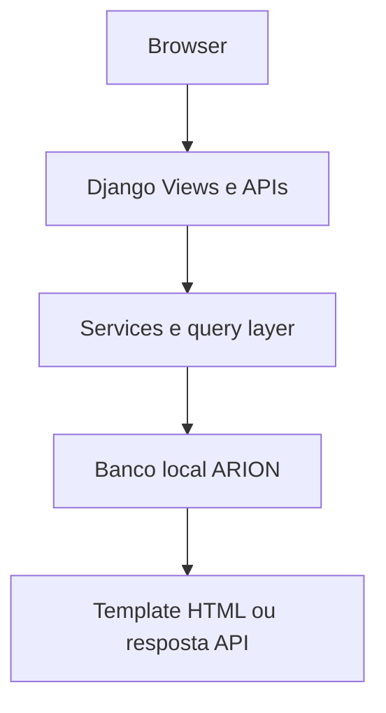
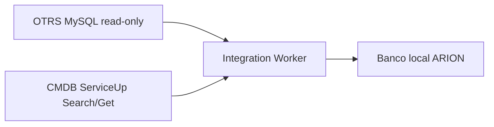
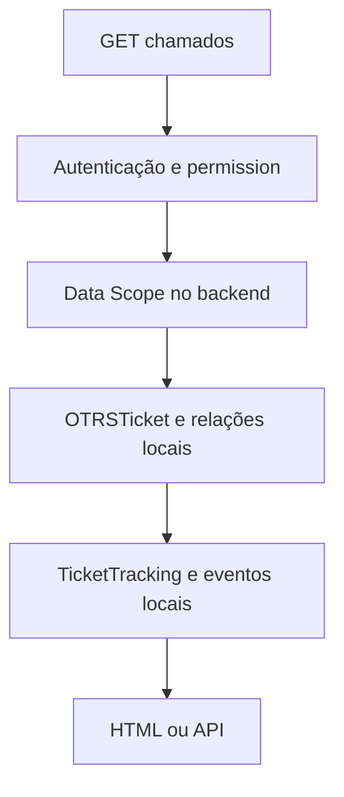
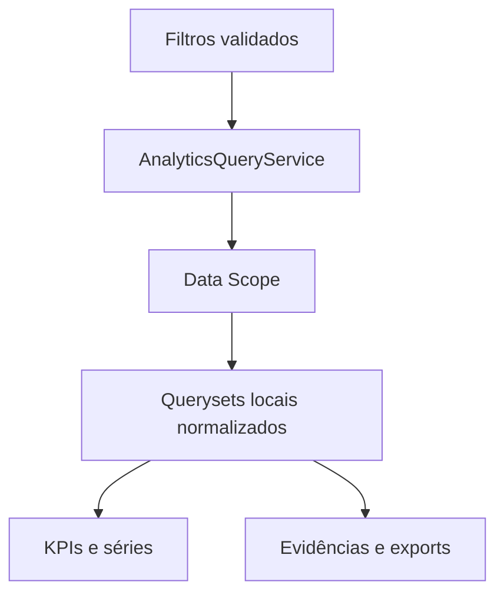
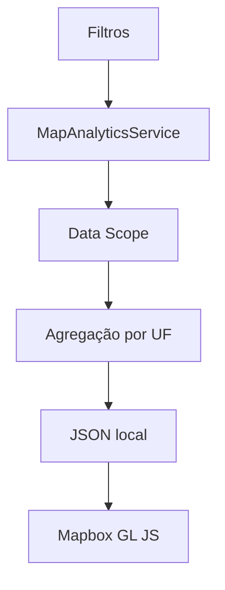
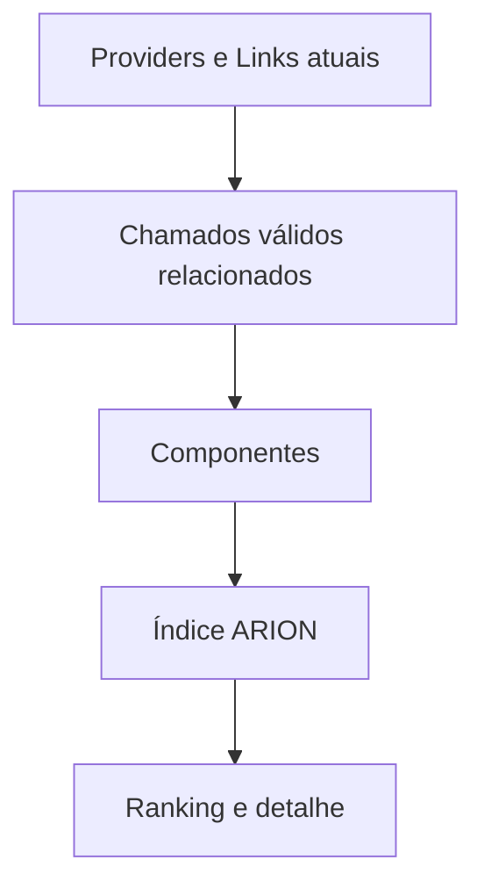
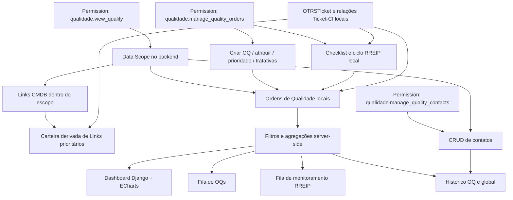
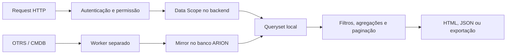

# Arquitetura do ARION OPS

## Visão geral da arquitetura V1 (IMPLEMENTADO)

O **ARION OPS** utiliza uma arquitetura de **monólito modular Django** com separação estrita entre o atendimento de requisições HTTP e o processo de sincronização com as fontes externas:

```text
Usuário
   ↓
HTTPS / Cloudflare
   ↓
Waitress
   ↓
Django
   ↓
MySQL
   ↓
Espelhos locais
├── CMDB
└── OTRS
```

Uma request web consulta exclusivamente o banco de dados local do ARION OPS. A sincronização ocorre fora do ciclo HTTP por meio do `integration_worker`, que lê as fontes oficiais (OTRS e CMDB) em modo somente leitura e atualiza os espelhos locais. Essa separação garante baixa latência nas telas e independência operacional caso o OTRS ou a CMDB apresentem lentidão temporária.

### Caminho da request



### Caminho de sincronização



O banco local acumula três papéis complementares: armazenamento dos dados próprios do produto, cache operacional dos espelhos sincronizados e camada analítica. OTRS e CMDB permanecem como fontes oficiais nos seus domínios; o ARION OPS não realiza escrita remota.

> **Fonte da verdade:** OTRS é a fonte oficial para tickets, filas, estados e tratativas; CMDB é a fonte oficial para ConfigItems, Links e Providers/ISP. O espelho local do ARION OPS atende consulta e análise operacional e depende do ciclo de sincronização para manter freshness.

## Apps Django instalados

| App | Tipo | Responsabilidade | Models principais | Serviços e entradas |
|---|---|---|---|---|
| `autenticacao` | Core | Login, sessão e páginas de acesso | User Django | forms, views, urls |
| `configuracoes` | Administração | Preferências, RBAC, Data Scope e documentação | `UserPreference`, `GroupDataScope`, `LegacyUserDataScope` | `access_control.py`, `data_scope.py`, `documentation.py`, views/forms |
| `auditoria` | Administração | Histórico de eventos relevantes | `AuditEvent` | `AuditService`, views |
| `integracoes` | Integração | Clients, execução de sync e espelhos CMDB/OTRS | `Integration`, `IntegrationRun`, `IntegrationSyncState`, `IntegrationLease`, mirrors | clients, services e management commands |
| `chamados` | Operacional | Fila e acompanhamento local | `TicketTracking`, `TicketTrackingNote`, `TicketTrackingEvent`, `TicketQueueView` | services, forms, views/API |
| `base_links` | Operacional e compatibilidade | Consulta atual de links; mantém models antigos e dimensões usadas pelo escopo | mirrors consultados pela Base; `Operadora`, `Projeto`; models legados | query services, views |
| `painel` | Analytics | Dashboard, Cockpit e consultas analíticas | `SavedAnalyticsView` | `services/analytics.py`, views/APIs |
| `mapa` | Analytics | Agregações por UF e modos geográficos | Sem model de domínio próprio | `services/analytics.py`, views |
| `rankings` | Analytics | Rankings e exportações | Sem model de domínio próprio | `services.py`, `performance.py`, `exports.py` |
| `relatorios` | Operacional e analítico | Importação privada e tratativa de Claro Multas | `PenaltyCompetence`, `PenaltySourceRow`, `PenaltyTreatmentRow` e modelos de auditoria financeira | services de importação, cálculo, tratamento e enriquecimento |
| `qualidade` | Operacional e analítico | Ordens de Qualidade, carteira derivada de links e análise de recorrência | `QualityOrder`, `QualityOccurrence`, `QualityTicket`, `QualityMonitoringCycle`, `QualityContact`, `QualityAuditEvent` | `QualityDataScopeService`, serviços das filas, OQ, ocorrência, RREIP e dashboard |
| `ari` | Produto | Conversas e artefatos em modo Preview | `AriConversation`, `AriMessage`, `AriAttachment`, `AriArtifact` | services de conversa, simulação e arquivos |

Os diretórios `projetos` e `importacoes` permanecem no repositório apenas por compatibilidade histórica e não integram `INSTALLED_APPS`. O diretório técnico do projeto Django chama-se `arion_geo/` para preservar estabilidade de imports, migrations, scripts de supervisão e pipeline de build.

## Fluxos protegidos

### Chamados



O espelho OTRS é somente leitura. Ações da tela alteram exclusivamente o acompanhamento local (`TicketTracking`), notas, eventos ou preferências de fila. `TicketTracking.ticket_external_id` referencia o identificador externo do OTRS como chave única desacoplada.

### Cockpit e analytics



Os filtros da interface não substituem a autorização. O Data Scope é aplicado ao queryset no backend antes de filtros analíticos, agregações, paginação e exportações. Dashboard e Cockpit compartilham a mesma semântica quando consultam o mesmo indicador.

### Mapa



O Mapa agrega dados do espelho local por UF e não realiza geocodificação externa nem chamadas remotas por request.

### Rankings



Os Rankings utilizam a dimensão Provider/ISP do espelho CMDB com Data Scope aplicado antes dos recortes e cálculos. Os componentes, universos e limites de interpretação estão em [Ranking de Provedores](..\05-funcionalidades\rankings.md).

### Qualidade Operacional



Dashboard, filas de Links Prioritários, OQs, monitoramento RREIP, diretório de contatos e histórico consultam exclusivamente dados locais com Data Scope aplicado no servidor. Operações de escrita local exigem `qualidade.manage_quality_orders` ou `qualidade.manage_quality_contacts` e geram registros na auditoria local e central.

## Matriz de módulos e dados

| Módulo | Dados locais consultados | Escrita local | Consulta OTRS/CMDB durante request |
|---|---|---|---|
| Dashboard e Cockpit | Tickets, estado e relações OTRS; Links/Providers CMDB conforme o indicador | Views analíticas salvas no Cockpit | Não |
| Mapa | Links CMDB, tickets OTRS e relação Ticket–CI para agregações geográficas | Não | Não |
| Rankings | Links/Providers CMDB e tickets/relações OTRS no período selecionado | Não | Não |
| Base | Link/Provider CMDB e relações/tickets OTRS em detalhes de histórico | Não (importação XLSX antiga é legado) | Não |
| Chamados | Tickets/relações OTRS, Links/Providers CMDB, acompanhamento e histórico ARION OPS | Tracking, notas, eventos e filas pessoais | Não |
| Administração e acesso | User, Group, Permission, escopos, preferências, integrações e auditoria | Formulários administrativos e services correspondentes | Não |
| Central de Relatórios | Linhas importadas e dados locais de OTRS/CMDB sob enriquecimento explícito | Tratativas, pausas, overrides, decisões e auditoria locais | Somente na ação administrativa explícita de enriquecimento; nunca em request de leitura |
| Qualidade Operacional | OQs, ocorrências, ciclos e snapshots; espelhos locais CMDB/OTRS | OQs, referências, ciclos RREIP, contatos e eventos locais | Não |
| ARI I.A | Conversas, mensagens, anexos e artefatos locais | Services ARI e storage privado associado | Não |

Consulte também [Dashboard](..\05-funcionalidades\dashboard.md), [Cockpit](..\05-funcionalidades\cockpit.md), [Mapa](..\05-funcionalidades\mapa.md), [Rankings](..\05-funcionalidades\rankings.md), [Base](..\05-funcionalidades\base.md), [Chamados](..\05-funcionalidades\chamados.md) e [Qualidade Operacional](..\05-funcionalidades\qualidade.md).

## Request, escopo e performance



RBAC define o que o usuário pode executar; Data Scope limita quais registros podem ser visualizados no backend. Em escopo `CUSTOM`, Operadora/Cliente e Projeto formam uma interseção (`AND`). Superuser técnico possui acesso global. Para detalhes de schema e tabelas físicas, consulte [Banco de Dados](banco-de-dados.md); para fontes e propriedade dos dados, [Fontes de Dados](fontes-de-dados.md); para cadências de sincronização, [Worker e Sincronização](worker-e-sincronizacao.md).

## Camadas da aplicação

- **Models e migrations:** schema local, constraints, índices e evolução controlada do banco.
- **Clients:** transporte e leitura segura da origem (OTRS MySQL read-only e CMDB GenericInterface Search/Get).
- **Services:** sincronização, identidade de negócio, Data Scope, analytics, reincidência, auditoria e acompanhamento local.
- **Views e APIs:** autenticação, verificação de permissões, validação de parâmetros e entrega HTML/JSON/exportação.
- **Forms:** validação de entrada no servidor.
- **Templates e Static:** interface server-rendered em Django Templates com CSS modular em `arion_geo/static/` e fontes JavaScript em `frontend_src/js/`.
- **Management commands:** `integration_worker` e utilitários administrativos controlados.

## Interfaces, build e PWA

Os templates são renderizados pelo Django; o CSS fica em `arion_geo/static/` e os fontes JavaScript em `frontend_src/`, fora da coleta estática pública de produção. Em desenvolvimento, `` serve os fontes; em produção, serve apenas os bundles fingerprinted, minificados e ofuscados em `arion_geo/static/arion_build/` mapeados por `var/arion-frontend-manifest.json`.

O PWA utiliza `/manifest.webmanifest` e `/service-worker.js` (servido com escopo `/` e `Cache-Control: no-store`). O catálogo `docs/08-releases/releases.json` é a fonte única da versão ativa para `/api/version/`, para a página **Atualizações e versões** e para o controle de atualização do PWA. Nenhuma página autenticada ou payload operacional é armazenado em cache offline.

## Escalabilidade

Na **V1 (IMPLEMENTADO)**, o ARION OPS opera como um **monólito modular Django** atendido por Waitress em loopback atrás do Cloudflare Tunnel, com MySQL local e um processo `integration_worker` dedicado à sincronização dos espelhos CMDB/OTRS.

A arquitetura foi estruturada para permitir evolução progressiva (**planejado / evolução possível**, conforme necessidade futura de demanda):

- **Otimização de consultas e índices:** ajuste fino de queries analíticas e índices compostos no MySQL;
- **Workers separados:** isolamento de rotinas de sincronização e processamento pesado em processos ou hosts independentes;
- **Cache:** introdução futura de cache compartilhado para agregações frequentes e sessões;
- **Escala vertical:** ampliação de recursos de CPU/memória para banco de dados e processo web;
- **Múltiplas instâncias web e load balancing:** execução de múltiplos processos/instâncias WSGI stateless compartilhando o mesmo banco MySQL;
- **Serviços especializados:** desmembramento pontual de cargas específicas apenas quando houver necessidade técnica comprovada.
