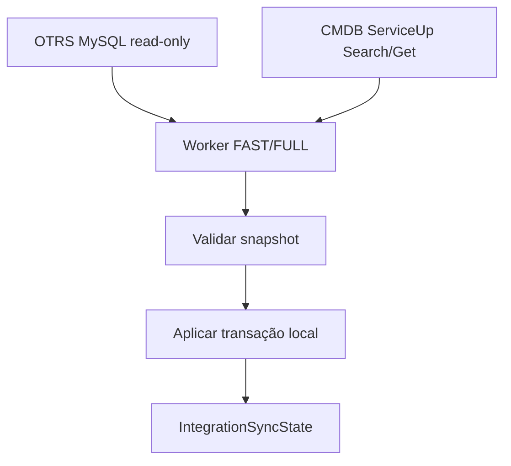
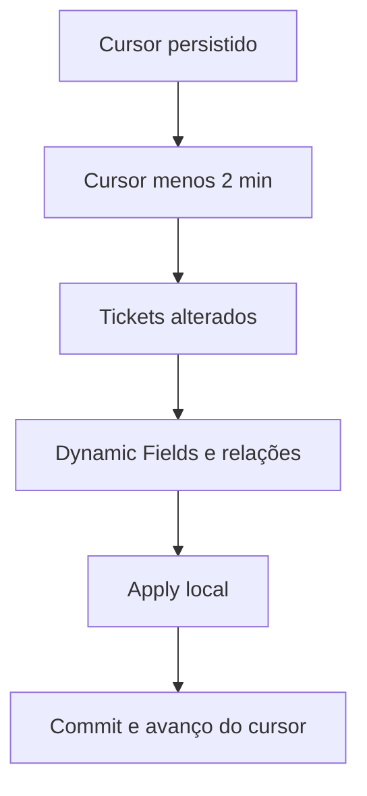
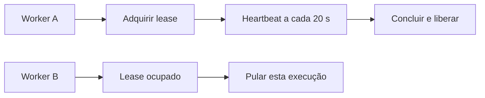

# Worker e Sincronização

## Processo separado

`integration_worker` é uma management command do ARION OPS executada em processo separado do servidor HTTP. Views, middleware e `AppConfig.ready()` não iniciam a sincronização. A web lê o último snapshot local e continua disponível se o worker parar; o dado pode ficar stale.

No supervisor Windows, `deploy/windows/run_process.py` carrega `.env` a partir da raiz fixa do projeto; variáveis herdadas do processo Windows têm precedência (`override=False`). Web e Worker são iniciados com o mesmo ambiente e diretório do projeto. Os scripts de start/status confirmam o processo filho do serviço correspondente; o status distingue supervisor ativo com filho indisponível/em reinício de serviço parado. As operações são limitadas aos supervisores ARION registrados.

### Compatibilidade com OTRS MySQL legado

TLS permanece obrigatório para qualquer host remoto por padrão. Um MySQL legado sem suporte a TLS só pode usar o opt-in existente `use_tls=False` + `allow_insecure_remote=True` quando o host também corresponder exatamente a `ARION_OTRS_LEGACY_NO_TLS_HOST`, configurado no ambiente do servidor. Essa exceção temporária não se aplica a CMDB, Brevo, Mapbox ou ao banco principal. O tráfego OTRS nesse modo não é criptografado; prefira restaurar TLS no MySQL ou usar túnel privado e remova a variável e o opt-in após a migração.

Antes de iniciar o worker em produção, configure a integração OTRS com host autorizado, schema, usuário somente leitura e credencial protegida; habilite-a somente após teste operacional autorizado. O worker suspende FULL/correlação quando desabilitada ou sem schema/credenciais; não altera a configuração automaticamente. `deploy/windows/production_check.py` é **código versionado de checagem**, não arquivo de credenciais. Divergências locais devem ser revisadas no Git; a configuração privada está em ambiente/arquivo de banco/integrações. Não sobrescrever ajuste local sem reconciliá-lo.

```powershell
.venv\Scripts\python.exe arion_geo\gerenciar.py integration_worker
.venv\Scripts\python.exe arion_geo\gerenciar.py integration_worker --once
.venv\Scripts\python.exe arion_geo\gerenciar.py integration_worker --interval 10
```

`--once` avalia um ciclo. `--interval` configura polling do scheduler (default 5 segundos, máximo 60), não a frequência de leitura das fontes.

## Cadências configuradas

O scheduler compara a ultima execucao e o estado sincronizado de cada fonte. OTRS FAST/FULL e a correlacao de Qualidade so rodam quando a integracao OTRS esta habilitada. FULL OTRS, quando devido, encerra a avaliacao daquela passagem e adia FAST; falhas aplicam backoff persistido de 2, 4, 8, 16 e ate 30 minutos. Execucao RUNNING/PENDING so volta a ser considerada apos o prazo de lease. CMDB e avaliado separadamente.

| Rotina | Cadência | Trabalho |
|---|---:|---|
| OTRS FAST | 2 min | Delta por `ticket.change_time`; janela de segurança de 2 min. |
| OTRS FULL | 30 min | Reconcilia as quatro filas configuradas para o Cockpit e relações; tem prioridade sobre FAST. Um FULL é antecipado quando a cobertura configurada ainda não foi aplicada. |
| CMDB FULL | 10 min | Busca Search/Get completa e reconcilia snapshot validado. |
| Entrada Cancelamentos | 2 min; retry até 30 min | Projeção local da fila `NOC - CANCELAMENTOS NGO`, após avaliar as sincronizações; lease/estado `cancellation_intake`, execuções `RECONCILE`. Exige FULL aplicado e origem recente. Nunca cria pedidos oficiais. |
| Histórico de backlog | 1 h após sucesso; backoff em falhas | `sincronizar_historico_backlog --apply`, chave `otrs_backlog_history`, leitura autorizada e substituição transacional apenas do cache local |
| Correlação Qualidade | 120 s por padrão; mínimo 30 s | Lote padrão 100, teto 200, filas configuradas e checkpoint por artigo; não envia TQ e não guarda corpos |
| Retry de falha | 2-30 min | Backoff progressivo persistido; preserva o mirror atual e informa a proxima tentativa. |

Primeira carga e reconstrução requerem FULL. O scheduler é verificado em intervalos menores do que as cadências. Horários abaixo mostram somente uma sequência ilustrativa de um ciclo estável; início real depende do processo e não é promessa de minuto civil:

```text
Exemplo relativo:       00   02   04   06   08   10   ...   30
OTRS FAST:               ·    F    F    F    F    F    ...    F
OTRS FULL:               U    ·    ·    ·    ·    ·    ...    U
CMDB FULL:               C    ·    ·    ·    ·    C    ...    C
```

FULL OTRS substitui/coordena o delta devido à precedência; os horários não definem SLA de freshness nem a ordem exata de início.

## Fluxo de dados



OTRS usa MySQL read-only com SQL restrito. CMDB usa `ConfigItemSearch` e `ConfigItemGet`. Apenas o banco ARION recebe writes. Requests de tela não abrem conexão remota.

### OTRS FAST

FAST inicia pelo cursor salvo, subtrai a safety window e seleciona tickets alterados antes de carregar Dynamic Fields/relações. Como `ticket.change_time` no OTRS é um `DATETIME` sem fuso, o limite da consulta é convertido para a hora local definida por `TIME_ZONE` e enviado sem `tzinfo`; o cursor interno continua timezone-aware. Após um apply bem-sucedido, o cursor avança para o início da leitura ou para o `change_time` observado mais recente, se posterior, mesmo quando o delta está vazio. A janela de segurança reaplica as alterações próximas ao limite na execução seguinte.



### OTRS FULL e CMDB FULL

OTRS FULL resolve os nomes exatos das filas selecionadas, lê tickets atuais e dimensões, lê relações/fields, faz upsert e reconcilia presença somente nas filas incluídas, preservando os demais registros. Por padrão, o conjunto do Cockpit contém `NOC - ATACADO`, `NOC - CANCELAMENTOS NGO`, `NOC - RETIRA EQUIPAMENTO` e `NOC – PENDENTE PAGAMENTO` (travessão no nome real). FAST usa o cursor compartilhado e exige exatamente esse conjunto após um FULL bem-sucedido com a mesma cobertura. CMDB FULL lista os IDs, carrega detalhes, valida classe/completude/duplicação e só então aplica a reconciliação. Um snapshot parcial não deve marcar como ausentes objetos não recebidos.

## Lease e concorrência

`IntegrationLease` mantém uma chave única por fonte, token proprietário, início, heartbeat e expiração. Heartbeat ocorre a cada 20 segundos; o lease vence depois de 180 segundos sem atualização. O lock persistido coordena workers e comandos manuais e permite recuperação após encerramento abrupto.



Execução sem lease não deve duplicar trabalho. O lease é coordenação, não garantia de exactly-once: services e upserts ainda precisam permanecer idempotentes.

## Correlacao incremental de Qualidade

Quando OTRS esta habilitado, `QualityCorrelationCheckpoint` controla a leitura incremental de artigos nas filas configuradas por `QUALITY_OTRS_QUEUE_NAMES` ou `ARION_QUALITY_OTRS_QUEUE_NAMES`. O worker consulta lotes limitados, procura o QID completo somente no corpo do artigo e guarda o maior ID lido como cursor. Corpos nao sao persistidos. Falhas preservam o cursor e aplicam backoff progressivo; integracao desabilitada suspende a rotina sem registrar uma nova falha.

## Falha, retry e snapshot


Se apply local falha, cursor FAST não avança. Snapshot incompleto ou inválido não é usado para marcar ausências. Requests web podem continuar; a consequência é menor freshness, não espera síncrona pela origem. Retry automático não substitui FULL controlado após corrupção/indisponibilidade prolongada.

## Estado e freshness

| Registro/campo | O que informa | Como interpretar |
|---|---|---|
| `IntegrationRun` | Tipo/operação, estado, início/fim, duração, contagens e detalhes sanitizados | Diferencie `SUCCESS`, `PARTIAL` e `FAILED`; uma tentativa recente não prova snapshot recente. |
| `IntegrationSyncState.last_started_at` | Tentativa mais recente iniciada | Pode ser falha ou execução ainda em curso. |
| `failure_count`, `last_error_at`, `last_error` | Falhas consecutivas e diagnóstico sanitizado | Indicam backoff e próxima tentativa; falhas de preparação do cliente OTRS também criam `IntegrationRun`. |
| `QualityCorrelationCheckpoint` | Cursor, ultima leitura, falha e contagem por fila de Qualidade | Nao confunda leitura sem vinculos com uma TQ correlacionada. |
| `last_success_at` | Último apply bem-sucedido | Freshness geral do último sucesso local. |
| `last_full_success_at` | Última reconciliação completa bem-sucedida | Confirma quando ocorreu o FULL mais recente. |
| `change_cursor` | Posição incremental OTRS FAST | Só avança depois do apply local. |
| `IntegrationLease.heartbeat_at` / `expires_at` | Dono vivo e vigência do lock | Ajuda a distinguir processo ativo de lease abandonado. |
| `source_last_seen_at` e `is_present_*` | Observação no snapshot da entidade | Não substituem o estado agregado da integração. |

Para avaliar freshness, compare tipo/status/duração do `IntegrationRun`, sucesso geral, sucesso FULL, cursor FAST e heartbeat. Não conclua que o dado está fresco apenas porque o worker está vivo.

### Conexão e processamento

`Integration.status` descreve a saúde conhecida da configuração/conexão: credencial ausente fica não configurada, autenticação ou política TLS requer atenção, e host/porta inacessível fica indisponível. Um erro de consulta, schema, transformação ou apply local não prova que a conexão caiu; nesse caso o estado de conexão é preservado enquanto o run e o estado de sincronização registram a falha. O diagnóstico exposto usa tipo e código seguro, nunca host, usuário, senha, token, SQL ou conteúdo de linha.

O FULL do OTRS lê em batches, carrega relações e Dynamic Fields em grupos limitados e aplica upserts locais em transação. FAST mantém cursor com janela de segurança; FULL reconcilia cobertura. A revisão preserva esses limites e não altera o desenho do mirror. A escrita agrupada mantém o padrão recomendado pelo [manual MySQL para otimizar inserções](https://dev.mysql.com/doc/refman/8.4/en/insert-optimization.html). Não foi executado benchmark contra produção; os tempos/contagens de `IntegrationRun` são evidência por execução e devem embasar qualquer otimização futura.

## Sincronização manual

Os comandos manuais usam o mesmo mecanismo de lease para evitar concorrência. Use-os somente em ambiente operacional autorizado; eles leem as origens e alteram mirrors/estado local.

```powershell
.venv\Scripts\python.exe arion_geo\gerenciar.py sincronizar_cmdb --apply
.venv\Scripts\python.exe arion_geo\gerenciar.py sincronizar_otrs --full --apply
.venv\Scripts\python.exe arion_geo\gerenciar.py sincronizar_otrs --fast --apply
```

Sem `--queue`, o comando usa as quatro filas do Cockpit. `--queue` pode ser repetido para um FULL de conjunto específico; FAST não aceita cobertura parcial. Um FULL parcial não torna o conjunto completo apto para FAST.

Não coloque credenciais nos argumentos de shell compartilhado nem em logs.

## Diagnóstico

Consulte também o [detalhamento técnico da sincronização OTRS](otrs-sincronizacao.md) para projeções, cursor, reconciliação e limites do FULL/FAST.

1. Confira `IntegrationRun` e diferencie sucesso completo, parcial e falha.
2. Compare `last_success_at`, `last_full_success_at` e `change_cursor`.
3. Verifique owner/heartbeat/expiração do lease e se há processo concorrente.
4. Confirme conectividade e configuração mascarada; nunca revele secret.
5. OTRS: confirme schema e resolução única de todas as filas do conjunto esperado para o Cockpit. CMDB: confirme Search e Get completos para as classes esperadas.
6. Corrija a causa e rode FULL controlado se o delta não for confiável.

### Troubleshooting por sintoma

| Sintoma | Checagem e recuperação |
|---|---|
| Worker parado | Confirme o processo/serviço que inicia `integration_worker` separadamente do HTTP. `--once` avalia só um ciclo e encerra. O processo web não é supervisor do Worker. |
| Lease ocupado ou aparentemente preso | Confira a chave e `heartbeat_at` / `expires_at`. Heartbeats ocorrem a cada 20 s; a expiração é 180 s. Depois de confirmar que o dono morreu, o próximo `acquire` pode tomar a lease expirada; não remova a linha manualmente enquanto houver um processo vivo. |
| Primeira inicialização sem dados | O primeiro OTRS delta exige cursor; rode OTRS FULL. CMDB faz FULL. Valide conexão e snapshot antes da aplicação. |
| FULL falhou | Confira `IntegrationRun` e erro sanitizado. Validação/consulta falha preserva o mirror anterior; corrija a origem/schema e refaça FULL controlado. |
| FAST falha por cursor inexistente | É esperado antes do primeiro FULL; o comando recusa avançar sem cursor. Rode FULL autorizado e depois acompanhe `change_cursor`. |
| Cursor não avança | FAST só persiste watermark após apply local bem-sucedido. Compare hora de término, `last_success_at` e `change_cursor`; dry-run não deve ser interpretado como apply. |
| OTRS/CMDB indisponível ou retry frequente | Worker aplica backoff progressivo até 30 min, mantendo mirror e cursor. Confira credencial mascarada, conectividade, timeout, schema/fila ou resposta Search/Get; não coloque secret em log. |
| Tela mostra snapshot stale | Worker vivo não garante leitura recente. Compare último FULL, último sucesso geral, `IntegrationRun` e lease. A aplicação continua usando o último snapshot local. |
| Relações Ticket–CI incompletas | Compare quantidade de relações atuais e resolvidas para Link; OTRS pode não ter relação válida ou ConfigItem pode não existir no mirror CMDB. Ver [OTRS](..\06-integracoes-e-dados\otrs.md) e [CMDB](..\06-integracoes-e-dados\cmdb.md). |

Não há política automática de retenção de `IntegrationRun` documentada como contrato. Models, tabelas físicas, ownership e restore estão em [Banco de Dados e Modelos](banco-de-dados.md); detalhes das origens em [OTRS](..\06-integracoes-e-dados\otrs.md) e [CMDB](..\06-integracoes-e-dados\cmdb.md); implantação em [Implantação e Produção](implantacao-e-producao.md).

## Identidade do processo supervisionado no Windows

Os scripts `start-arion.ps1`, `stop-arion.ps1`, `restart-arion.ps1` e `status-arion.ps1` atuam somente nos supervisores ARION identificados pelos locks por papel. O arquivo `.pid` do papel é o PID do supervisor; `.launcher.pid` é o launcher iniciado pela `.venv`; `.child.pid` é o PID efetivo que executa Waitress ou o comando `integration_worker`. Cada PID tem um registro de horário de criação e executável.

O status usa APIs nativas para confirmar que o processo continua vivo e que o PID conserva o horário de criação registrado. Isso evita falsos estados por PID inexistente ou reutilizado. No Python Microsoft Store, o PID do launcher pode diferir do interpretador que executa o serviço; ambos são informados e a relação é verificada pela árvore de processos. O encerramento também confere o horário de criação antes de atuar sobre um processo efetivo separado, sem buscar/encerrar outros Python do servidor.
