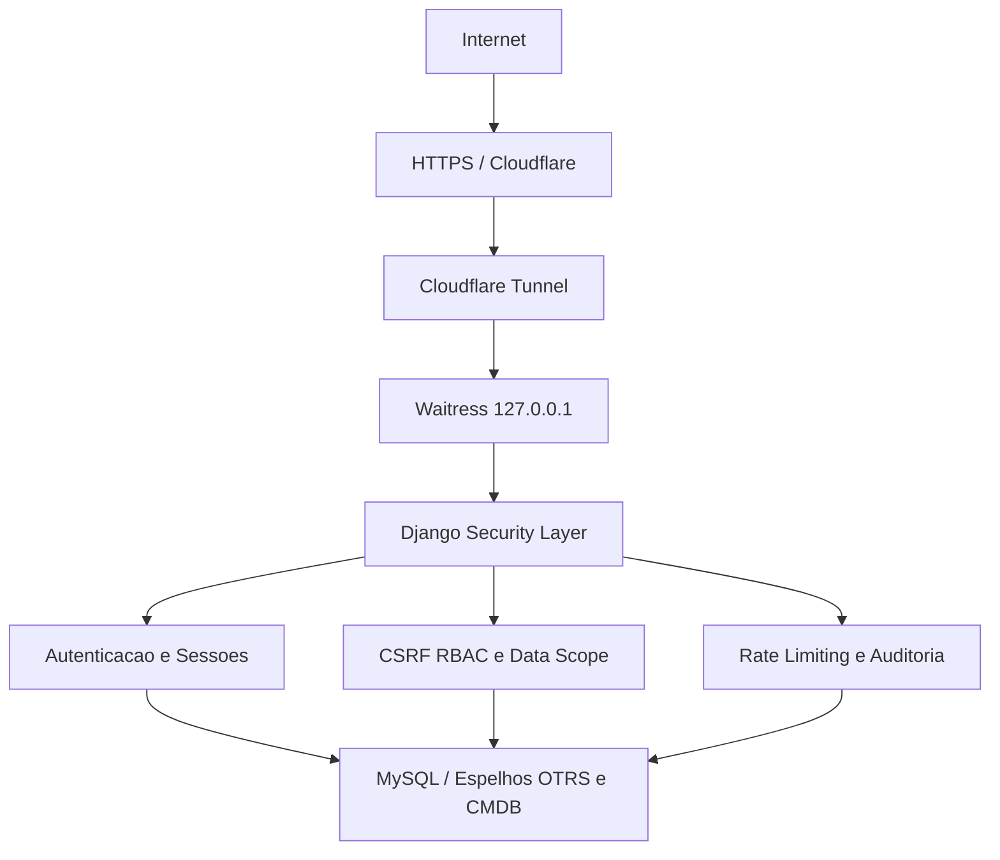

# Validação de Segurança — ARION OPS

> **SEGURANÇA VALIDADA:** {{badge:VALIDADO NO ESCOPO TESTADO}}
> **V1.3.0** · **02/11/2026**
> **0 vulnerabilidades críticas abertas**
> **0 vulnerabilidades altas abertas**
> **0 vulnerabilidades médias abertas no código**
> **0 vulnerabilidades baixas abertas no código**
> Segurança validada no escopo e na versão avaliados.

Durante a etapa de fechamento da V1, o ARION OPS passou por uma rodada dedicada de validação de segurança.

A avaliação utilizou revisão automatizada e assistida por múltiplos modelos de inteligência artificial de alto desempenho, combinada com inspeção do código-fonte, testes ativos controlados em ambiente local e validações passivas da superfície de produção.

O objetivo foi avaliar os principais vetores de ataque aplicáveis ao sistema e confirmar o funcionamento das camadas de proteção implementadas.

---

## O que foi testado

A validação cobriu os 28 domínios e vetores abaixo no escopo da versão **1.3.0**:

| Vetor / Domínio avaliado | Escopo da verificação | Status |
| :--- | :--- | :--- |
| Autenticação e login | Fluxo de credenciais, rejeição de acessos anônimos e mensagens genéricas | {{badge:VALIDADO}} |
| Proteção contra tentativas repetidas | Bloqueio temporário por IP e conta após falhas sucessivas | {{badge:VALIDADO}} |
| Sessões e logout | Cookies `HttpOnly`, `SameSite=Lax`, rotação de chave e invalidação de sessão no logout | {{badge:VALIDADO}} |
| CSRF | Exigência de token CSRF em todas as operações de escrita (`POST`) | {{badge:VALIDADO}} |
| RBAC / permissões | Isolamento estrito entre perfis operacionais, gestão e administração | {{badge:VALIDADO}} |
| Data Scope | Filtragem server-side obrigatória por Operadora e Projeto em listagens, KPIs e APIs | {{badge:VALIDADO}} |
| IDOR | Bloqueio de acesso direto a objetos fora do escopo ou pertencentes a outros usuários | {{badge:VALIDADO}} |
| Privilege Escalation | Impossibilidade de auto-promoção a administrador, superuser ou alteração de grupo próprio | {{badge:VALIDADO}} |
| Mass Assignment | Formulários com campos explícitos e bloqueio de atributos administrativos injetados | {{badge:VALIDADO}} |
| SQL Injection | Consultas parametrizadas via Django ORM e conector read-only validado | {{badge:VALIDADO}} |
| XSS | Auto-escape nos templates Django, sanitização em JS e bloqueio de esquemas perigosos | {{badge:VALIDADO}} |
| Open Redirect | Validação de destino interno seguro no parâmetro `next` de login e logout | {{badge:VALIDADO}} |
| Formula Injection em planilhas | Neutralização de prefixos executáveis (`=`, `+`, `-`, `@`) em exportações CSV e XLSX | {{badge:VALIDADO}} |
| PDF / HTML Injection | Escape HTML e isolamento por `Content-Security-Policy: sandbox` em artefatos e relatórios | {{badge:VALIDADO}} |
| Uploads maliciosos | Rejeição de executáveis, scripts, HTML/SVG ativo e arquivos fora da allowlist | {{badge:VALIDADO}} |
| Path Traversal | Normalização de nomes de arquivo e armazenamento privado fora de `/static/` | {{badge:VALIDADO}} |
| Double Extension | Bloqueio de nomes compostos com extensões intermediárias executáveis ou de script | {{badge:VALIDADO}} |
| MIME / Magic Bytes | Verificação da assinatura binária real do arquivo e inspeção estrutural de pacotes ZIP/XLSX | {{badge:VALIDADO}} |
| Exposição de secrets | Mascaramento de credenciais em telas administrativas, logs e eventos de auditoria | {{badge:VALIDADO}} |
| Arquivos sensíveis | Inacessibilidade HTTP a `.env`, scripts de deploy, mídia privada e chaves locais | {{badge:VALIDADO}} |
| PWA / cache | Service Worker restrito a assets estáticos públicos e `Cache-Control: private, no-store` | {{badge:VALIDADO}} |
| Web Storage | Uso de `localStorage` e `sessionStorage` restrito a estado visual de UI sem segredos | {{badge:VALIDADO}} |
| Command Injection | Ausência de execução de shell com entrada de usuário (`shell=True`, `eval`, `exec`) | {{badge:VALIDADO}} |
| SSRF | Clientes de integração restritos às origens configuradas pelo administrador | {{badge:VALIDADO}} |
| Integrações OTRS e CMDB | OTRS em modo somente leitura (`SELECT`) e CMDB com transporte `HTTPS` obrigatório | {{badge:VALIDADO}} |
| Segurança do MySQL | Conta dedicada da aplicação com privilégios restritos ao schema operacional | {{badge:VALIDADO}} |
| Headers HTTP | `X-Frame-Options: DENY`, `X-Content-Type-Options: nosniff`, `Referrer-Policy` e `Permissions-Policy` | {{badge:VALIDADO}} |
| HTTPS / proxy / Cloudflare | Bind local em loopback (`127.0.0.1:8100`), suporte a proxy seguro e HSTS em produção | {{badge:VALIDADO}} |

---

## Resultado dos testes

> **Informação:** **34 testes automatizados de regressão de segurança**
> **Resultado: 34 aprovados**
> **Testes ativos controlados:** **Aprovados nos cenários avaliados**

| Modalidade de verificação | Escopo executado | Resultado |
| :--- | :--- | :--- |
| **34 testes automatizados de regressão de segurança** | Suíte dedicada cobrindo autenticação, sessão, CSRF, RBAC, Data Scope, IDOR, uploads, exportações, conectores e headers | **Resultado: 34 aprovados** |
| **Testes ativos controlados** | Verificações em ambiente local controlado combinadas com inspeção passiva não destrutiva da superfície de produção | **Aprovados nos cenários avaliados** |

---

## Controles de segurança

Os controles abaixo encontram-se ativos e validados na arquitetura da V1.3.0:

- **Autenticação protegida** — exigência de sessão autenticada em todas as rotas operacionais, analíticas e administrativas.
- **Sessões seguras** — cookies com flags `HttpOnly`, `SameSite=Lax`, expiração configurada e flag `Secure` ativa sob HTTPS.
- **Rate limiting de login** — limitação de tentativas repetidas por IP e por identificador de conta, com registro em auditoria.
- **CSRF** — validação de token anti-CSRF em todas as submissões e mutações de estado.
- **RBAC** — controle de acesso baseado em grupos e permissões granulares do Django aplicadas no backend.
- **Data Scope** — isolamento de dados por Operadora e Projeto aplicado diretamente nas queries de banco de dados.
- **Proteção contra IDOR** — validação de propriedade e escopo antes de qualquer leitura, edição ou download de recurso.
- **Django ORM / consultas parametrizadas** — prevenção contra injeção SQL na camada de persistência e nos espelhos operacionais.
- **Escape contra XSS** — codificação contextual em templates e sanitização explícita na renderização dinâmica do frontend.
- **Validação de uploads** — verificação combinada de extensão, MIME, assinatura binária (magic bytes), limite de tamanho e estrutura interna.
- **Proteção de exportações** — neutralização de fórmulas em planilhas CSV/XLSX, inclusive quando precedidas por caracteres de controle.
- **Credenciais protegidas** — segredos de integração cifrados em repouso via Windows DPAPI e jamais reexibidos na interface.
- **OTRS somente leitura** — conector MySQL operando com sessão `READ ONLY`, validação de comandos `SELECT` e bloqueio de tabelas sensíveis.
- **CMDB com HTTPS obrigatório** — validação estrita do esquema `https://` tanto no formulário administrativo quanto no cliente HTTP.
- **MySQL com usuário restrito** — segregação de privilégios de banco de dados sem uso de conta administrativa pela aplicação.
- **Waitress em loopback** — servidor WSGI vinculado exclusivamente a `127.0.0.1:8100`, sem exposição direta de porta na rede.
- **Cloudflare Tunnel** — publicação externa intermediada por borda TLS e túnel autenticado até o serviço local.
- **Headers de segurança** — políticas ativas de bloqueio de framing, MIME sniffing, referrer, permissões de navegador e cache privado.
- **Auditoria administrativa** — trilha persistente de eventos de segurança e administração com sanitização automática de metadados.

---

## Camadas de defesa

Representação da arquitetura de proteção em profundidade do **ARION OPS**:

```text
Internet
↓
HTTPS / Cloudflare
↓
Cloudflare Tunnel
↓
Waitress — 127.0.0.1
↓
Django
├── Autenticação
├── Sessões
├── CSRF
├── RBAC
├── Data Scope
├── Rate Limiting
└── Auditoria
↓
MySQL / Espelhos OTRS e CMDB
```



---

## Avaliação assistida por IA

A revisão utilizou múltiplos agentes e modelos avançados de inteligência artificial como apoio à análise de código, busca de padrões vulneráveis, geração de cenários de teste, validação de controles e revisão dos resultados.

A IA foi utilizada como ferramenta de apoio técnico; os resultados apresentados correspondem aos testes e evidências efetivamente executados no ambiente avaliado.

---

## Resultado

A V1 avaliada não possui vulnerabilidades críticas, altas, médias ou baixas abertas no código após a rodada de correções e retestes.

Os principais controles de segurança do ARION OPS foram validados nos cenários executados, incluindo autenticação, sessão, autorização, escopo de dados, proteção contra injeções, controle de uploads, exportações e integrações.

Os itens restantes identificados são relacionados a hardening e configuração de infraestrutura, não a vulnerabilidades abertas no código da aplicação.

---

## Documentação técnica

Para consulta aos detalhes arquiteturais, matriz completa de vetores e evidências técnicas da avaliação, acesse:

- [Arquitetura de Segurança](03-seguranca-e-qualidade/seguranca.md)
- [Relatório Completo de Segurança da V1](03-seguranca-e-qualidade/relatorios/relatorio-de-seguranca-v1.md)
- [Auditoria da V1.3.0](03-seguranca-e-qualidade/auditorias/auditoria-seguranca-v1.3.0-2026-11-02.md)

---

**ARION OPS**
**NOC ATACADO**

Concepção e desenvolvimento:
**Pedro Cavalcanti**

**ARION Serviços de Telecomunicações**

