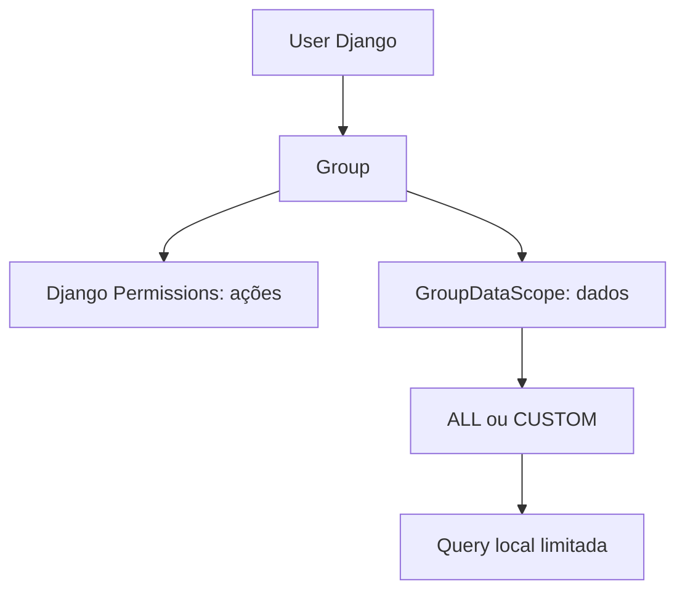
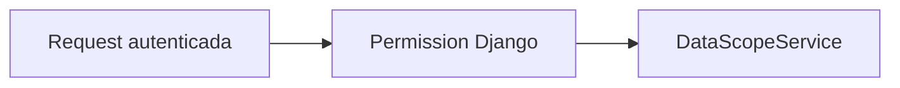
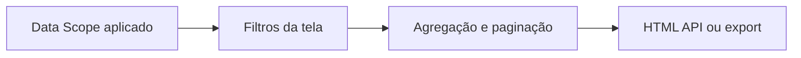

# Usuários, Grupos e Escopos de Dados

## RBAC e Data Scope

RBAC responde que ações a pessoa pode executar e usa Django Groups/Permissions. Data Scope responde quais linhas ela pode consultar e deve ser aplicado no backend antes de filtros, agregações, paginação, detalhes, APIs e exports. A cobertura efetiva por módulo e a limitação de Relatórios estão na matriz abaixo. Os dois controles são independentes.

## Grupos e permissões

`bootstrap_access` provisiona Administrador do Sistema, Gestor, Analista NOC, Consulta / Auditoria e **Gestão**. São defaults de código, não um inventário dos grupos/permissões atualmente instalados no servidor. Os codenames e grants vêm de `access_control.py`; não existe `user.role`. O formulário da Central configura o grupo principal; as views conferem permissions no backend ainda que um link esteja oculto. A senha/ativação tem [política própria](../03-seguranca-e-qualidade/politica-de-senhas-e-acessos.md).

Django permite múltiplos grupos. Permissions funcionais concedidas pelos grupos seguem Django Auth. Para dados, scopes CUSTOM de cada grupo são acumulados com interseção AND. Um grupo com ALL não remove restrição CUSTOM de outro.

### Formulário de permissões

O formulário de grupos permite buscar por rótulo, expandir ou recolher módulos e consultar a contagem de permissões selecionadas. Mudanças locais são sinalizadas antes de sair e durante o salvamento. A lista continua derivada de `managed_permissions()` e toda alteração passa pelas validações da view e de `AccessGroupForm`; o navegador não concede acessos automaticamente.

## `GroupDataScope`

OneToOne com Group, modo `ALL`/`CUSTOM`, M2M `allowed_operators` e `allowed_projects`. Os catálogos de escopo são dimensões administrativas e não significam automaticamente Provider/ISP.

- ALL remove restrição adicional de linhas, mas não concede permission funcional.
- CUSTOM exige simultaneamente Cliente/operadora permitida E Projeto permitido.
- CUSTOM sem itens autorizados produz queryset vazio.
- Ausência de scope em qualquer grupo torna o acesso de dados restritivo.
- Superuser técnico é global e não precisa de scope.

Para `CMDBLinkMirror`, filtro usa `contracting_client` ou valor raw autorizado e `business_project`. `legacy_project` só entra como fallback quando `business_project` está vazio; caso contrário poderia ampliar escopo entre projetos. As duas dimensões são AND. Para model legado `base_links.CMDBLink`, filtros usam IDs `operadora_id` e `projeto_id`.

## Fluxo e administração

Administração de Usuários, Grupos e Escopos fica em `/configuracoes/administracao/` e requer `manage_users`, `manage_groups` ou `manage_data_scopes`. Django `/admin/` é manutenção técnica. Data Scope controla dados operacionais; não substitui RBAC.

`LegacyUserDataScope` preserva configuração individual anterior e não é fonte atual de consulta. Migração para scope por grupo manteve defaults restritivos quando escopos não eram consistentes. Auditoria registra mudanças relevantes sem senha. Testes cobrem ALL/CUSTOM, interseção, scope ausente/vazio, multi-grupo e superuser.

## Matriz funcional conferida no código 1.4.0

Permissions abaixo são verificadas em views/services; a tabela não concede acesso. `configuracoes.` é o prefixo dos controles gerais; outros apps têm namespace próprio. A ausência de permission normalmente produz 403 após login; objeto fora do queryset autorizado retorna 404 ou erro de validação contextual. APIs não autorizam por botão visível.

| Área / rota | Consulta | Escrita ou ação adicional | Recorte de dados |
|---|---|---|---|
| Início `/painel/` | Login | Preferências pessoais | KPIs executivos só com `configuracoes.view_dashboard` e escopo |
| Dashboard `/dashboard/` | `configuracoes.view_dashboard` | Sem edição da origem | Links/tickets escopados antes de agregados |
| Chamados `/chamados/` | `configuracoes.view_operational_tickets` | `manage_operational_tickets` para tracking/notas | Fila atual autorizada; gravação revalida objeto e revisão |
| Cockpit `/cockpit/` | `configuracoes.view_cockpit` | `save_analytics_views` para salvar visão | Query compartilhada escopada; exportação usa o recorte autorizado |
| Mapa `/mapa/`, `/base/api/mapa/` | `configuracoes.view_map` | Sem edição da origem | Escopo antes de opções, UF, drawer e métricas |
| Rankings `/rankings/` | `configuracoes.view_rankings` | Exportações do módulo sob a mesma consulta autorizada | Link/ticket e detalhe escopados |
| Base `/base/` | `configuracoes.view_base` | `export_base`; `import_cmdb` para importador legado disponível | Espelhos e APIs escopados; XLSX não é sync oficial |
| ARI `/ari/` | `configuracoes.view_ari` | Conversas/anexos próprios no Preview | Titularidade da conversa; não consulta carteira CMDB/OTRS |
| Qualidade `/qualidade/` | `qualidade.view_quality` | `manage_quality_orders`, `manage_quality_contacts`, `delete_qualityorder`, conforme ação | `QualityDataScopeService`; contatos e históricos também escopados |
| Cancelamentos `/cancelamentos/` | `cancelamentos.view_cancellations` | Permissions específicas abaixo | `CancellationScope`; inclui dashboard, opções, valores e export |
| Relatórios `/relatorios/` | `relatorios.view_reports` | Tratativas têm permissions específicas; **criação/upload/importação também usam `view_reports`** | **Planilha/competência não é segregada por `GroupDataScope` nesta versão** |
| Conta, aparência, Sobre, Atualizações | Login | Somente própria conta/tema; senha usa validação específica | Contexto pessoal; notas públicas ao usuário autenticado |
| Usuários | `configuracoes.manage_users` | Criar exige também `create_users`; detalhe exige `view_access_status` | Cadastro administrativo global, não carteira operacional |
| Grupos / documentação técnica | `configuracoes.manage_groups` | Catálogo de permissions selecionáveis | Acesso administrativo; não conceder para simples consulta operacional |
| Escopos | `configuracoes.manage_data_scopes` | Edita o escopo do grupo | Afeta todos os integrantes, não apenas um usuário |
| Auditoria / Sistema | `configuracoes.view_audit_log` / `view_system_info` | Não autorizam triagem ou envio | Diagnóstico administrativo central; histórico dentro do módulo mantém seu recorte |
| Integrações | `configuracoes.view_integrations` | `manage_integrations`, `run_integrations`, `inspect_integrations` por operação | Configuração global; contagens operacionais aplicam escopo |

### Cancelamentos e financeiro

Todos os controles do módulo exigem consulta e objeto autorizado, além da permission da ação:

| Codename `cancelamentos.*` | Capacidade |
|---|---|
| `triage_cancellations` | Aprovar/rejeitar; revisar associação em conjunto com alteração de etapa |
| `assign_cancellations` | Assumir/atribuir responsável local |
| `change_cancellation_stage` | Tratativa, edição operacional e movimentos abertos |
| `reopen_cancellations` | Reabrir, também exigindo alteração de etapa |
| `manage_cancellation_pending` | Pendências/equipamentos; itens financeiros exigem acesso financeiro adicional |
| `complete_cancellations` | Conclusão normal validada |
| `override_cancellation_completion` | Exceção justificada à conclusão, junto das demais validações |
| `view_cancellation_finance` | Valores, pendências financeiras, gráficos e colunas financeiras |
| `manage_cancellation_finance` | Obrigações e encaminhamento, junto da consulta financeira |
| `export_cancellations` | CSV do mesmo recorte; sem consulta financeira, não inclui valores |
| `configure_cancellations` | Configuração da projeção de Entrada OTRS |
| `import_cancellation_history` | Importação controlada por comando, ator e destino permitido |

Sem acesso financeiro, valores não entram no HTML/JSON/tooltips do dashboard. Triagem sem vínculo confiável ou com links mistos fica restrita ao acesso global autorizado. No CUSTOM, Cancelamentos exige identidades autorizadas no snapshot e no link atual, associação atual válida quando necessária e ausência de relações externas ao escopo. Dados legados não ganham acesso por título ou nome parecido.

### Relatórios e limite de escopo

`relatorios.edit_treatments`, `override_treatments`, `finalize_treatments`, `finalize_with_pending`, `reopen_treatments`, `export_treatments`, `delete_penaltycompetence` e `delete_finalized_penaltycompetence` controlam ações específicas. Porém `_competences()` não recebe usuário e as linhas/Original são consultados por competência; a consulta de enriquecimento não comprova segregação da planilha. Portanto `view_reports` não equivale a acesso somente leitura nem a carteira CUSTOM.

Até existir uma correção funcional homologada, conceder acesso a Relatórios somente a pessoas autorizadas ao conjunto de competências disponibilizado. Não afirmar proteção por cliente/projeto para Original, workspace ou exportação apenas porque o grupo é CUSTOM. Esta é pendência concreta de código, não corrigida por esta revisão documental.

## Defaults de grupos e concessões instaladas

| Grupo provisionado | Intenção/capacidades iniciais | Escopo inicial |
|---|---|---|
| Administrador do Sistema | Catálogo geral/admin e Relatórios, gestão/arquivamento de OQ; não inclui automaticamente Cancelamentos nem gestão de contatos | ALL |
| Gestor | Consulta dos módulos gerais/Qualidade/Relatórios, gestão local de Chamados/OQs, visões salvas e parte das ações de tratativa | CUSTOM vazio |
| Analista NOC | Consulta geral/Qualidade, tracking de Chamados e visões salvas | CUSTOM vazio |
| Consulta / Auditoria | Consulta geral/Qualidade e auditoria; sem Relatórios por padrão | CUSTOM vazio |
| Gestão | Consulta geral/Qualidade e `view_reports`, sem administração; ressalva de escrita/escopo de Relatórios acima | CUSTOM vazio |

O bootstrap preserva grupos existentes: não reaplica toda a matriz em cada migrate. Acrescenta permissões de segurança de conta ao Administrador existente; Gestão recebe defaults se nova ou sem grants. Permissões de Cancelamentos são expostas para concessão **explícita** e nenhum grupo as recebe automaticamente. Verificar o grupo instalado, não apenas o nome.

**Lacuna de catálogo:** `qualidade.manage_quality_contacts` existe e é exigida pelas views de contatos, mas `managed_permissions()` não a inclui no seletor operacional de grupos. Não confundir com `manage_quality_orders`. Superuser mantém acesso; eventual concessão técnica já existente deve ser conferida pela equipe, e a exposição pelo seletor requer ajuste próprio de código. Esta auditoria não cria grants.

`manage_users` permite atribuir o grupo principal existente; `manage_groups` altera grants; `manage_data_scopes` altera a carteira. Delegar essas permissions exige revisão administrativa. Proteções de último administrador e formulários sem `is_staff`/`is_superuser` não substituem governança de quem pode conceder grupos. Procedimentos: [Administração operacional](../03-seguranca-e-qualidade/administracao-operacional.md).
