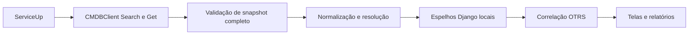

# CMDB ServiceUp · visão geral

{{badge:CMDB}} {{badge:REMOTE}} {{badge:MIRROR}} {{badge:READ-ONLY}} {{badge:RECONSTRUÍVEL}}

Esta seção descreve a integração que o ARION OPS implementa para ler ConfigItems da CMDB ServiceUp, validar um snapshot, manter dois espelhos locais e relacioná-los às relações Ticket–ConfigItem sincronizadas do OTRS. ConfigItemID é a identidade técnica usada no mirror e no vínculo OTRS; Number é separado e não serve como chave relacional. A CMDB permanece a fonte oficial dos atributos de origem; cliente e projeto derivados de Name são classificações ARION, não novos dados oficiais.

## Cobertura levantada no código

| Medida | Total documentado | Critério de contagem |
|---|---:|---|
| Operações ServiceUp | 2 | Caminhos distintos POST usados pelo cliente: Search e Get. |
| Classes CMDB mapeadas | 2 | Operadoras e Links de internet em CMDBSyncService.CLASSES. |
| Entidades mirror principais | 2 | CMDBOperatorMirror e CMDBLinkMirror. |
| Campos nas whitelists do sync | 65 | 24 nomes em OPERATOR_FIELDS e 41 em LINK_FIELDS, incluindo campos derivados e FK. |
| Famílias de consultas locais rastreadas | 8 | Consultas representativas catalogadas com IDs CMDB-Q001 a Q008. |
| Transformações rastreadas | 8 | Etapas catalogadas com IDs CMDB-T001 a T008. |
| Áreas consumidoras operacionais | 8 | Base, Chamados, Dashboard, Cockpit, Rankings, Mapa, Qualidade e Relatórios. |
| Fluxos agendados de sync CMDB | 1 | Um FULL de ambas as classes pelo integration_worker a cada 10 minutos. |
| Pendências de validação externa | 6 | Contrato vigente, envelopes reais, tipos dinâmicos, limites, paginação e comportamento TLS da instância. |

Os totais descrevem inventários explícitos desta documentação e não pretendem medir todo o código Python do produto. O exame foi local: nenhuma chamada à ServiceUp, importação, escrita de mirror ou consulta a produção foi feita nesta tarefa. O método HTTP, os caminhos relativos, os payloads que o cliente envia, os campos que ele lê e suas regras de validação estão confirmados no código. A forma exata da resposta externa depende da configuração GenericInterface e só pode ser confirmada contra um contrato autorizado.

## Percurso dos dados

O acesso é JSON sobre HTTPS via GenericInterface; não há SQL direto contra a CMDB. O fluxo de produção usa Search para IDs sem limite local e Get em lotes. O serviço valida as duas classes antes de reconciliar presença. Uma resposta incompleta ou inconsistente cancela o snapshot e preserva os mirrors já aplicados.

As operações recebem os identificadores documentais CMDB-API001 (ConfigItemSearch) e CMDB-API002 (ConfigItemGet). As consultas locais têm IDs CMDB-Q001–Q008 e as transformações centrais CMDB-T001–T008; eles facilitam auditoria e não são nomes fornecidos pela API.

## Navegação

- [02 · Fonte ServiceUp](cmdb-fonte-serviceup.md)
- [03 · Catálogo de endpoints](cmdb-endpoints.md)
- [04 · Estruturas de resposta](cmdb-respostas.md)
- [05 · Dicionário de dados](cmdb-dicionario.md)
- [06 · Entidades](cmdb-entidades.md)
- [07 · Relacionamentos](cmdb-relacionamentos.md)
- [08 · Normalização](cmdb-normalizacao.md)
- [09 · Sincronização](cmdb-sincronizacao.md)
- [10 · Espelho local](cmdb-espelho-local.md)
- [11 · CMDB + OTRS](cmdb-otrs.md)
- [12 · Geolocalização](cmdb-geolocalizacao.md)
- [13 · Indicadores](cmdb-indicadores.md)
- [14 · Módulos consumidores](cmdb-consumidores.md)
- [15 · Qualidade](cmdb-qualidade.md)
- [16 · Segurança](cmdb-seguranca.md)
- [17 · Diagnóstico](cmdb-diagnostico.md)
- [18 · Rastreabilidade](cmdb-rastreabilidade.md)
- [19 · Glossário](cmdb-glossario.md)
- [20 · Limitações e cobertura](cmdb-limitacoes.md)

O índice do portal, a busca e a navegação anterior/próxima usam a lista autorizada em configuracoes.documentation.DOCUMENTS. O conteúdo destas páginas continua sendo Markdown versionado, renderizado pelo mesmo portal interno usado pela seção [OTRS](otrs.md); RBAC, tema e estilos permanecem centralizados.

## Implementação principal

| Camada | Arquivo / símbolo |
|---|---|
| HTTP e JSON | aplicativos/integracoes/clients/cmdb.py · CMDBClient |
| Configuração e segredo | aplicativos/integracoes/views.py · _cmdb_client; CMDBConfigurationForm |
| Extração e whitelist | aplicativos/integracoes/services/cmdb_sync.py · CMDBSyncService |
| Identidade de negócio | aplicativos/integracoes/services/link_business_identity.py |
| Semântica do ISP | aplicativos/integracoes/services/semantics.py |
| Agendamento | aplicativos/integracoes/management/commands/integration_worker.py |
| Comando de execução | aplicativos/integracoes/management/commands/sincronizar_cmdb.py |
| Entidades locais | aplicativos/integracoes/models.py · CMDBOperatorMirror, CMDBLinkMirror |
| Correlação Ticket–CI | aplicativos/integracoes/models.py · OTRSTicketConfigItem; otrs_sync.py |

## Limite da fonte

CMDB ServiceUp fornece ConfigItems. O ARION cria uma cópia operacional local para filtros, consultas e análise. OTRS é fonte separada de tickets e relações. O espelho local não substitui nem atualiza os cadastros oficiais.

## Ver também

[OTRS](otrs.md), [Worker e Sincronização](../02-arquitetura/worker-e-sincronizacao.md), [Banco de Dados e Modelos](../02-arquitetura/banco-de-dados.md), [Base de Links](../05-funcionalidades/base.md), [Rankings](../05-funcionalidades/rankings.md) e [Mapa](../05-funcionalidades/mapa.md).
