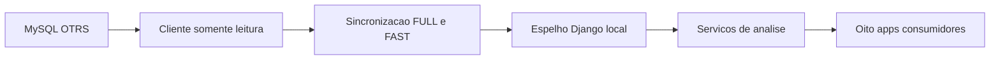

# OTRS · Visão geral

## Escopo e fonte da verdade

O OTRS é a fonte oficial de tickets, estados, filas e relações operacionais. O ARION OPS mantém um espelho local para consulta e análise; as páginas web trabalham nesse espelho e não consultam o MySQL remoto a cada requisição.

Esta área descreve o que foi confirmado no código e diferencia isso de tipos observados em um estudo local anterior. Nenhuma conexão ao OTRS ou servidor de produção foi aberta durante esta revisão. A aplicação não grava no OTRS.

## Cobertura desta referência

| Item levantado | Quantidade | Critério |
|---|---:|---|
| Tabelas OTRS de domínio | 21 | Tabelas com leitura de conteúdo em rotinas de sync, estudo ou Qualidade |
| Pares tabela/coluna | 80 | Campos únicos mencionados em projeções e filtros dessas rotinas |
| Famílias de consulta | 48 | Formatos SQL distintos catalogados; não é quantidade de execuções |
| Apps consumidores do espelho | 8 | Apps Django com consulta ao mirror ou suas relações |
| Diagramas de fluxo | 5 | Diagramas compatíveis com o renderizador documental |
| Páginas nesta seção | 18 | Esta visão geral e 17 páginas técnicas |

O snapshot de esquema local de 23/10/2026 fornece tipos para 79 dos 80 campos. `article_data_mime.a_body` é exigido pelo caminho de correlação, mas seu tipo não consta no estudo sanitizado. A estrutura atual do servidor não foi revalidada nesta tarefa. Os critérios e pendências estão em [Limitações e cobertura](otrs-limitacoes.md).

## Arquitetura

## Acesso rápido

- [Origem e evidências](otrs-origem-dados.md)
- [Catálogo de tabelas](otrs-tabelas.md) e [dicionário de dados](otrs-dicionario.md)
- [Relacionamentos](otrs-relacionamentos.md) e [catálogo SQL](otrs-consultas-sql.md)
- [FULL, FAST e worker](otrs-sincronizacao.md)
- [Estados](otrs-estados.md), [datas](otrs-datas.md) e [indicadores](otrs-indicadores.md)
- [Módulos consumidores](otrs-consumidores.md) e [Qualidade/TQ](otrs-qualidade-tq.md)
- [Segurança](otrs-seguranca.md), [diagnóstico](otrs-diagnostico.md), [glossário](otrs-glossario.md), [rastreabilidade](otrs-rastreabilidade.md)

As páginas reutilizam o catálogo Markdown já existente. Busca textual, sumário contextual, navegação lateral, tema claro/escuro e proteção de acesso continuam sendo fornecidos pelo portal de Documentação. Diagramas e blocos SQL são somente explicativos e não executam consultas.

## Limites do espelho

O universo sincronizado é deliberadamente limitado às quatro filas configuradas para Cockpit e aos artigos das filas de Qualidade configuradas. O mirror não é uma réplica integral do OTRS nem um histórico completo de todas as mudanças. Ausência no mirror pode significar fora do escopo, remoção lógica do conjunto observado, falha de atualização ou dado ainda não sincronizado.

O percurso por campo está na [matriz de rastreabilidade](otrs-rastreabilidade.md). Para interpretar categorias como `RESOLVED` ou datas operacionais, consulte [Estados](otrs-estados.md) e [Datas](otrs-datas.md), em vez de inferir semântica pelo nome exibido.
