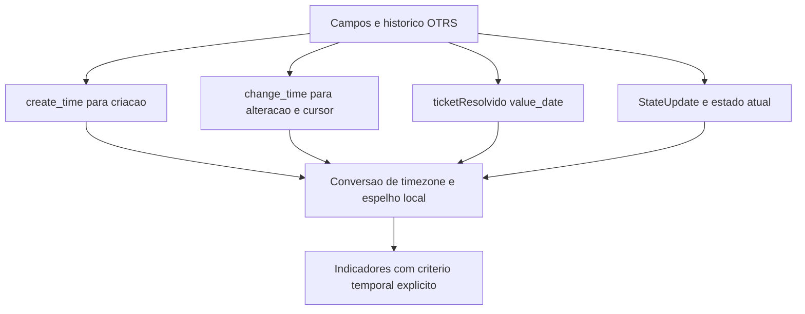

# Datas operacionais OTRS

## Campos e origem

| Marco | Origem OTRS | Mirror/cálculo | Uso e ressalva |
|---|---|---|---|
| Criação do ticket | ticket.create_time | source_created_at | Período de criação, envelhecimento e recorrência |
| Última alteração | ticket.change_time | source_changed_at | Cursor FAST; não é hora de resolução |
| Data de resolução | Dynamic Field ticketResolvido em dynamic_field_value.value_date | resolved_at | Só existe se o campo estiver configurado e houver valor |
| Última entrada no estado terminal atual | MAX(ticket_history.create_time) para StateUpdate e estado atual | terminal_state_at | Só calculada quando o ticket atual está em estado terminal reconhecido |
| Data do cancelamento | Mesmo histórico terminal quando categoria atual é CANCELED | canceled_at | Não equivale a data de resolução |
| Criação de artigo | article.create_time | Selecionada na reconciliação manual | Não é data de resolução |
| Leitura/sync | Relógio do ARION | IntegrationRun, source_last_seen_at, source_synced_at | Marcação local, não timestamp do OTRS |

O código exige que Dynamic Fields CodigoFechamento e ticketResolvido existam para sync terminal e sejam do tipo Ticket. O campo opcional de procedência também é lido quando identificado como dropdown de Ticket. Campo ausente ou valor vazio produz dado local vazio/null; não há data inventada.

## Caminho dos marcos temporais

## Conversão temporal

source_datetime aceita datetime do driver ou string ISO. Se o valor for naive, torna-o aware com o timezone configurado no Django; se já vier aware, conserva o offset. Para FAST, o cursor aware é convertido ao timezone padrão e enviado como datetime naive, como esperado pelo campo DATETIME consultado. O timezone efetivo depende da configuração do ambiente.

O código não lê offset de timezone da coluna OTRS, então não há prova independente de qual timezone o servidor usou ao gravar valores naive. A interpretação usa a configuração do ARION. Esse ponto deve ser considerado ao comparar minutos próximos a limites de período.

## Fallback operacional e estados

Para tickets resolvidos, vários serviços usam resolved_at e depois terminal_state_at como data de fechamento operacional. Cancelamentos usam canceled_at e fallback para terminal_state_at em contextos que aceitam esse evento. Isso não altera source_created_at nem cria uma transição de estado ausente.

terminal_state_at é obtida pelo maior create_time de StateUpdate para IDs terminais e só é aplicada quando state_id coincide com o estado atual. Se o ticket foi reaberto, a consulta atual não atribui a ele um terminal_at antigo. resolved_at do Dynamic Field é lido independentemente do estado atual e pode representar valor histórico após uma reabertura; indicadores devem exigir também status atual RESOLVED.

## Período de criação não é período de resolução

“Criado no período e atualmente resolvido” seleciona source_created_at no intervalo e consulta o status atual. “Resolvido durante o período” seleciona a data operacional de resolução no intervalo e exige estado atual operacional RESOLVED. Cockpit, Rankings e Mapa usam campos/datasets conforme cada métrica; não interprete todo total como fluxo de resoluções.

O backlog do Cockpit é snapshot atual de OPEN/PENDING, não reconstrução de estoque histórico. A série de fluxo constrói entradas por source_created_at e fechamentos pela data operacional, sujeito à cobertura histórica e validação dos horários.

Links: [estados](otrs-estados.md), [indicadores](otrs-indicadores.md), [limitações](otrs-limitacoes.md).
