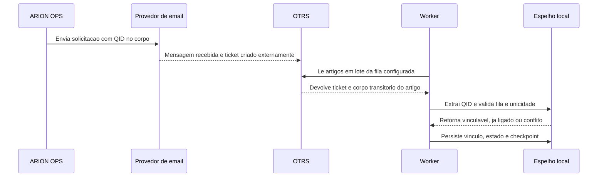

# Qualidade e correlação de TQ com OTRS

## Escopo

Uma TQ é uma solicitação de tratativa criada no módulo Qualidade. O ARION OPS prepara o conteúdo e pode enviá-lo pelo provedor configurado (Brevo/API ou SMTP, conforme configuração), mas o envio não prova que o OTRS criou um ticket. O vínculo só é confirmado quando um artigo lido do OTRS contém o identificador completo da TQ.

O caminho é dividido em envio, recebimento externo, leitura de artigos, validação do identificador e atualização local. A aplicação não cria nem altera tickets no OTRS.

## Identidade e envio

Cada QualityTreatment recebe um QID imutável no formato ARION-QID- seguido de 32 caracteres hexadecimais em maiúsculas. Há unicidade no banco local e o método de salvamento preserva o QID existente. O identificador fica no corpo da mensagem, não no assunto, para permitir correlação após o recebimento.

O envio depende das configurações de integração, permissão explícita de envio real, destinatário válido e estado elegível da tratativa. Resultado ambíguo não libera repetição automática: a tela de reconciliação consulta o OTRS antes de permitir uma ação manual autorizada. O fluxo usa os serviços tq_email.py, tq_delivery.py e tq_correlation.py.

## Leitura incremental dos artigos

O worker consulta as filas configuradas em QUALITY_OTRS_QUEUE_NAMES; o padrão de código é NOC - QUALIDADE ATACADO. O lote tem padrão 100 artigos e teto 200. O intervalo padrão é 120 segundos, com mínimo de 30 segundos. A leitura é separada do método SQL genérico porque o corpo do artigo contém dados sensíveis.

Para cada fila, QualityCorrelationCheckpoint guarda o maior ID de artigo processado. A próxima leitura começa 40 IDs antes do cursor para cobrir atrasos e empates; o processamento é idempotente e reconhece vínculos existentes. O cursor avança até o maior article_id lido, mesmo quando não há QID reconhecido. Cada fila grava o próprio checkpoint após seu lote. Erros preservam o cursor e usam nova tentativa exponencial com limite de 30 minutos.

O cliente exige as colunas necessárias no schema, resolve o nome exato da fila e lê artigo, ticket, fila e estado. O parâmetro queue_names da atualização dos tickets já vinculados não é um filtro SQL: a consulta atualiza metadados por IDs de ticket previamente ligados.

## Validação e prevenção de vínculo incorreto

O parser aceita o QID completo em texto simples ou HTML. O artigo é elegível somente na fila permitida e deve conter exatamente um QID. O vínculo usa o QID, não o assunto do e-mail, o número digitado ou uma aproximação textual.

O serviço bloqueia estes casos:

- fila fora da lista autorizada ou ticket ausente do conjunto disponível;
- nenhum QID completo, mais de um QID ou QID sem TQ local correspondente;
- TQ já ligada a outro ticket;
- ticket já ligado a outra TQ.

Um vínculo novo grava o ID interno do ticket, TN, snapshots da fila e estado e os horários de vínculo/leitura. Se a TQ aguardava o OTRS, ela passa para acompanhamento. Conflitos são registrados na auditoria sem copiar o corpo do artigo. Artigos sem QID não produzem vínculo.

## Reconciliação manual

Para uma tentativa de envio incerta, a reconciliação exige o TN exato e o QID daquela TQ. A consulta externa limita a busca a 20 artigos do ticket e usa LIKE no corpo como pré-filtro; em seguida, o parser confere o QID completo. A fila precisa estar autorizada e apenas um ticket/artigo compatível pode ser aceito. A reconciliação vincula, mas nunca envia e-mail.

O pré-filtro LIKE pode examinar vários corpos de artigo do ticket. Seu custo depende dos índices, do volume e do mecanismo do OTRS; não foi medido no servidor. A consulta e o corpo não devem ser copiados para logs ou chamados.

## Sequência

O portal renderiza fluxogramas simples e diagramas de sequência. A sequência abaixo mostra os atores e as etapas sem sugerir confirmação síncrona do provedor:

O envio de e-mail e a criação do ticket são eventos externos; o diagrama não implica confirmação síncrona entre eles.

## Componentes e referências

- Leitura externa: aplicativos/integracoes/clients/otrs.py, métodos fetch_quality_articles e find_quality_ticket_article_by_qid.
- Agendamento e backoff: aplicativos/integracoes/management/commands/integration_worker.py.
- Checkpoint e correlação incremental: aplicativos/qualidade/services/tq_otrs_correlation.py.
- Extração do QID e vínculos sem conflito: aplicativos/qualidade/services/tq_correlation.py.
- Envio e resultado ambíguo: aplicativos/qualidade/services/tq_email.py e tq_delivery.py.
- Modelos locais: QualityTreatment, QualityTreatmentIdentity e QualityCorrelationCheckpoint em aplicativos/qualidade/models.py.
- Reconciliação manual: aplicativos/qualidade/views.py, ação quality_treatment_reconcile_send.

Veja também [Consultas SQL](otrs-consultas-sql.md), [Segurança](otrs-seguranca.md), [Diagnóstico](otrs-diagnostico.md) e [limitações](otrs-limitacoes.md).
