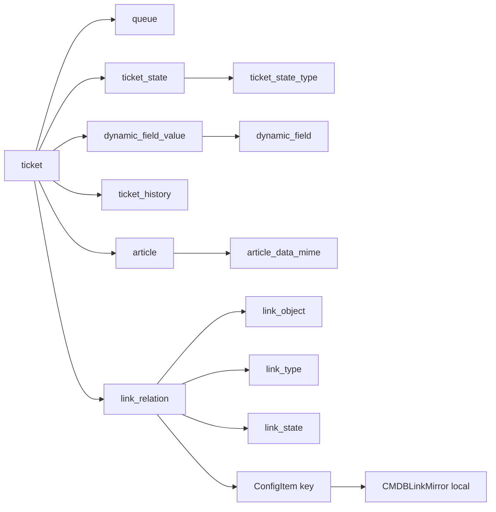

# Relacionamentos OTRS

## Relações que o código usa

| Relação | Evidência | Uso e cardinalidade |
|---|---|---|
| Ticket → fila | ticket.queue_id resolvido por queue.id | Muitos tickets para uma fila; nomes exatos delimitam o snapshot |
| Ticket → estado | ticket.ticket_state_id resolvido por ticket_state.id | Muitos tickets para um estado; o estado atual é um por ticket |
| Estado → tipo técnico | ticket_state.type_id resolvido por ticket_state_type.id | Muitos estados por tipo; tipo é armazenado, mas categoria ARION vem do nome |
| Ticket → dimensões | priority, type, service e sla IDs resolvidos em mapas em memória | Cada campo pode não ter valor; não há JOIN SQL no sync principal |
| Ticket → Dynamic Fields | dynamic_field_value.object_id compara com ticket ID; field_id compara com definição | Campo pode não ter valor; código resolve IDs pelo nome antes de ler valores |
| Ticket → histórico | ticket_history.ticket_id; estado e tipo são filtros | Muitos eventos por ticket; último evento terminal correspondente ao estado atual vira data local |
| Ticket ↔ ConfigItem | link_relation com IDs de objeto e chaves polimórficas | Relação muitos-para-muitos; duas orientações são normalizadas para ticket e ConfigItem |
| Artigo → ticket e MIME | JOIN article.ticket_id = ticket.id e article_data_mime.article_id = article.id | Um ticket pode ter muitos artigos; corpo só é lido na correlação TQ |
| ConfigItem → classe | JOIN configitem.class_id = general_catalog.id e filtro de namespace | Classificação do estudo, não informação copiada para o mirror |

Além disso, relações OTRS com type_id/state_id são resolvidas por nome em link_type e link_state. No snapshot local havia FKs declaradas para alguns IDs de dimensão. O pipeline não depende dessa declaração: descobre colunas, resolve dimensões e valida nomes em memória.

## Relação Ticket–ConfigItem

source_object_id e target_object_id identificam o tipo de objeto por link_object. source_key e target_key são texto; seu significado depende do objeto correspondente. O código resolve Ticket e ITSMConfigItem, aceita ambas as orientações, exige tipo DependsOn e estado Valid, e conserva a chave do ConfigItem.

O código não executa JOIN direto link_relation → ticket/configitem. A validação final confere que o ticket retornado pertence ao snapshot e faz match do ConfigItem por CMDBLinkMirror.source_config_item_id. Se não encontra Link local, preserva a relação externa e a registra sem FK local de Link. Relações repetidas são deduplicadas por (ticket external_id, ConfigItem ID normalizado, tipo).

Não há garantia de uma relação por ticket. O mesmo ticket pode ter vários CIs e um CI pode aparecer em vários tickets. A tabela local admite isso e aplica unique constraint em ticket, ConfigItem e tipo da relação.

## JOINs executados

O fluxo de artigo faz quatro junções: artigo para ticket; ticket para fila; ticket para estado; MIME para artigo. O fluxo de classe faz uma junção: ConfigItem para catálogo geral. Essas junções estão no estudo e/ou na correlação, não no snapshot FULL/FAST de tickets.

## Diagrama resumido

Consulte o [dicionário](otrs-dicionario.md), a [sincronização](otrs-sincronizacao.md) e o [espelho](otrs-espelho-local.md).
