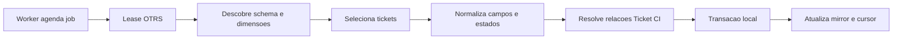

# Sincronização OTRS: FULL, FAST e worker

## Universo e ordem

O scheduler único chama a sincronização CMDB quando vence sua cadência; para OTRS, primeiro garante a cobertura FULL das quatro filas configuradas para Cockpit: NOC - ATACADO, NOC - CANCELAMENTOS NGO, NOC - RETIRA EQUIPAMENTO e NOC – PENDENTE PAGAMENTO. O travessão da última fila faz parte do nome configurado. FAST só roda depois de FULL bem-sucedida para a assinatura atual de filas.

Cadências do código em integration_worker.py: FAST a cada 2 minutos, FULL a cada 30 minutos, CMDB a cada 10 minutos e verificação do scheduler por padrão a cada 5 segundos. O worker tem lease próprio e não deve ser executado em mais de uma instância ativa.

## Fluxo

## FULL

1. Resolve cada fila pelo nome exato; IDs não são fixados no serviço.
2. Descobre tabelas/colunas e exige as dimensões necessárias.
3. Lê dimensões de estado, prioridade, tipo, serviço, SLA e tipo de estado.
4. Seleciona todos os tickets das filas e valida IDs/TNs ausentes ou duplicados.
5. Lê valores autorizados de Dynamic Fields e o último StateUpdate para tickets atualmente terminais.
6. Resolve objetos, tipos e estados de link pelo nome, lê relações em batches de 400 e normaliza ambas as direções.
7. Valida colisões do TN com IDs externos locais antes de escrever.
8. Em apply, grava dimensões, tickets e relações dentro de transação local; marca como ausentes tickets/relações não retornados no conjunto conciliado.
9. Só após sucesso o comando persiste cursor e data de FULL, e fecha IntegrationRun como sucesso.

FULL não pagina o SELECT de tickets. As consultas de relações, Dynamic Field Value e histórico são divididas em batches; o conjunto de tickets é lido e validado em memória antes da reconciliação. Esse custo é uma limitação documentada, não uma suposição de falha.

## FAST e cursor incremental

FAST usa IntegrationSyncState.change_cursor, que é a data do início da leitura bem-sucedida ajustada para cobrir o maior source_changed_at encontrado. A consulta aplica ticket.change_time >= cursor - 120 segundos no timezone local do ARION. Repetir a janela captura mudanças com precisão de segundos e atraso de sincronização.

Além dos tickets nas filas selecionadas, FAST inclui IDs que já estavam no mirror dessas filas. Assim, uma mudança de fila pode ser observada e o registro pode passar a is_present_in_queue=False se saiu do universo. Tickets retornados voltam a ser reconciliados; campos relacionais são relidos para os tickets afetados. FAST não marca como ausente todo registro que simplesmente não apareceu na consulta incremental.

FAST é recusado se cursor não existe ou se a última FULL não cobre exatamente a assinatura de filas atual. Faça FULL antes de mudar a cobertura.

## Locks, commits e recuperação

Lease("otrs") impede FULL/FAST manual concorrente; o worker detém o lease enquanto chama o comando em modo scheduler. O lease tem heartbeat; worker o renova em thread, e a sincronização também mantém seu heartbeat. Há um lease separado para impedir dois schedulers.

O comando manual é dry-run se não receber --apply. Dry-run calcula diferenças, mas não grava mirror nem cursor. Em falha, a transação local não é concluída, o estado de sync e IntegrationRun registram erro sanitizado e o snapshot anterior permanece. O worker conta falhas e aplica backoff exponencial de 2 até 30 minutos; estado pendente/em execução com lease vencido pode ser reavaliado.

Restart abrupto do worker não promete execução exactly-once. O lease expira e o job elegível pode ser reexecutado; a upsert local usa IDs únicos e reconciliação para não duplicar tickets. Se o processo terminar durante a transação local, o banco deve reverter a transação aberta; o estado anterior continua sendo a referência até nova execução confirmada.

## Cenários operacionais

| Cenário | Efeito confirmado no código |
|---|---|
| Ticket novo na fila observada | FULL cria; FAST cria se change_time está dentro da janela |
| Ticket passa de aberto para resolvido | Atualiza estado bruto/categoria e campos de data lidos; FULL ou FAST |
| Estado bruto muda de Resolvido para Encerrado | Nome bruto permanece; categoria normalizada continua RESOLVED |
| Ticket reabre | Estado atual deixa de ser terminal; leitura atualiza snapshot e terminal_state_at não é preenchida para o estado aberto |
| Ticket muda para outra fila observada | FAST inclui ID previamente conhecido e atualiza fila; permanece presente se a fila de destino está no conjunto |
| Ticket muda para fila fora do conjunto | FAST pode observar por ID conhecido e marca não presente no conjunto; FULL também reconcilia o conjunto |
| Ticket recebe outro ConfigItem | Relações dos tickets selecionados são relidas; relação local é criada/atualizada e duplicatas lógicas são reduzidas |
| OTRS indisponível | Run falha, erro é sanitizado, cursor não avança; último snapshot local permanece |
| Worker morre no meio do job | Lease expira; job pode repetir; não há garantia de efeitos exatamente uma vez fora da transação local |

## Evidências de execução

IntegrationRun registra operação, estado, contagens e duração. IntegrationSyncState registra cursor, sucessos, falhas e última FULL. Logs imprimem totais e warnings de estado; falhas são registradas por classe/código seguro, sem título ou corpo de artigo.

Veja [consultas SQL](otrs-consultas-sql.md), [espelho](otrs-espelho-local.md) e [diagnóstico](otrs-diagnostico.md).
